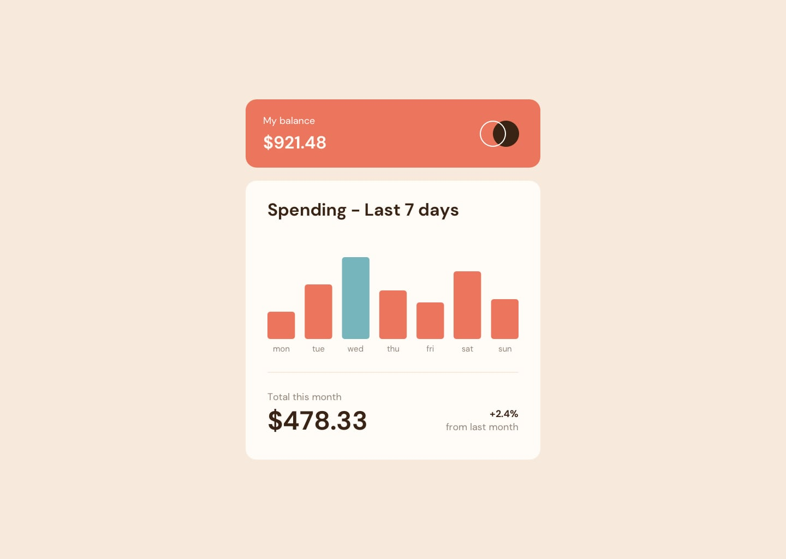
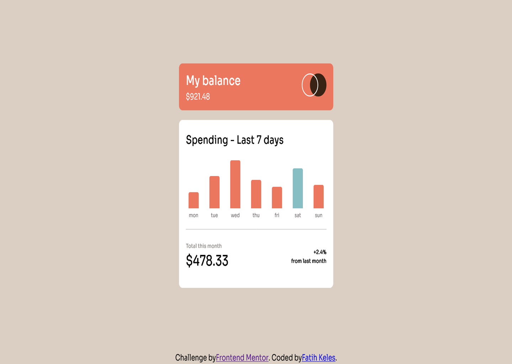

# Frontend Mentor - Expenses chart component

This is my solution to the Tip Calculator App challenge on Frontend Mentor.

## Overview

### Design vs My Solution

| Original Design | My Solution |
|---|---|
|  |  |

## Links

- [Live Site :]()
- [Repository :](https://github.com/fatihkeles0/frontend-mentor/tree/main/expenses-chart-component-main)

## Built with

- HTML
- CSS
- Vanilla JavaScript
